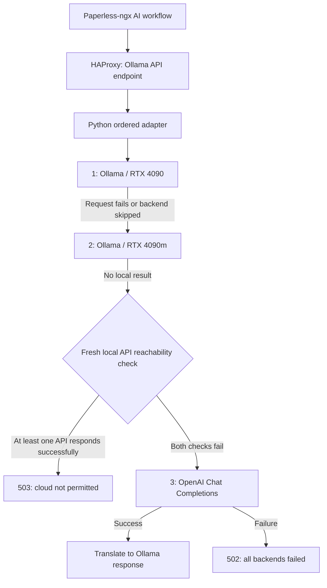

# paperless-ai-local-cloud-fallback

An infrastructure portfolio project for document classification with **ordered local inference and a guarded cloud fallback**: RTX 4090 → RTX 4090m → OpenAI API.

Paperless-ngx sends Ollama-compatible requests through HAProxy to a small Python adapter. The adapter tries the configured local providers sequentially and translates supported requests to OpenAI Chat Completions only when the cloud policy permits it. This preserves a local-first workflow while providing a recovery path when both local APIs fail reachability checks.

This is an **integration and infrastructure project**: provider routing, HTTP protocol adaptation, deployment hardening, configuration, and failure testing. Paperless-ngx, Ollama, HAProxy, and the models are third-party software. It does not claim model development, training, or authorship of those systems. The reference was prepared with AI-assisted tooling from a read-only deployment inspection.

## Architecture



The diagram represents request decisions inside the adapter; local providers do not call each other. GPU names are configuration labels, not runtime hardware detection.

## Components and evidence

| Component | Observed role |
| --- | --- |
| Paperless-ngx 3.3.1 | Built-in AI workflow client; Ollama backend, `qwen3:14b`, 600-second request timeout |
| HAProxy 3.2 | One checked adapter target, rather than GPU load balancing |
| Python standard library adapter | Sequential routing, cloud gate, request/response translation |
| Two Ollama endpoints | Configured primary and secondary local inference providers |
| OpenAI Chat Completions | `gpt-4.1-mini` configured as cloud model |
| systemd | Production adapter supervision and credential delivery |
| Docker Compose | Production Paperless/HAProxy; optional containerized reference adapter |

See [the evidence report](docs/VERIFICATION.md) for the boundary between observed configuration, isolated tests, and unverified operation, and [software attribution](THIRD_PARTY.md) for upstream components and licensing status.

## Quick start: tests without providers

Requires Python 3.12+; no pip dependencies, Docker, credentials, model downloads, or real documents are needed.

```sh
python3 -m unittest discover -s tests -v
python3 scripts/check_publication.py
```

Tests run the actual reference handler against ephemeral loopback HTTP backends with synthetic payloads. The test transport maps every allowed upstream to loopback and rejects other destinations. Production providers are never contacted. Cloud TLS and real credentials are not exercised.

## Configuration and setup

1. Copy `config/config.example.json` to `config/config.json`. Replace the `.example.invalid` hosts with your own local Ollama endpoints. Keep the array order primary → secondary. Set each port if it differs from 11434.
2. Ensure the same requested local model is installed on both Ollama instances. There is no automatic local model substitution or GPU discovery.
3. Review `cloud_only_if_unreachable` before using document data. Its default here is `true`, matching the inspected deployment.
4. Create `secrets/openai-key` locally with your own API key. This ignored file is intentionally absent from the repository. Make it readable by the runtime user only as far as deployment requires. Never put a key into `.env`, source code, shell history, or a commit.
5. For Compose, copy `.env.example` to `.env`, then run `docker compose config --quiet` and `docker compose up --build -d` in a separate test environment. The container secret must be readable by UID 65532; use appropriate ownership/ACLs. File-backed Compose secrets are not an encrypted secret store.
6. The host endpoint is bound to loopback: `http://127.0.0.1:11434`. For a Paperless container, connect it to this project's Compose network and use `http://ollama-lb:11434`. Apply `examples/paperless-ai.env` to a compatible Paperless deployment; this repository does not deploy the document database or import documents.

The reference adapter is containerized for portability; the observed production adapter is a systemd service. `examples/paperless-ai.service` preserves the production hardening pattern with generic paths. Native execution is also possible:

```sh
ADAPTER_CONFIG="$PWD/config/config.json" \
CREDENTIALS_DIRECTORY="$PWD/secrets" \
ADAPTER_BIND=127.0.0.1 ADAPTER_PORT=11434 \
python3 adapter/adapter.py
```

`ADAPTER_CONFIG`, `ADAPTER_BIND`, and `ADAPTER_PORT` are reference additions. `CREDENTIALS_DIRECTORY` supplies a directory containing `openai-key` (systemd sets this for `LoadCredential`). The standard library server has no authentication or TLS termination: keep it on a trusted network or behind authenticated infrastructure. Do not expose it publicly as supplied.

## Routing and model mapping

Supported inference endpoints are `POST /api/generate` and `POST /api/chat`. `GET /health`, `/api/version`, and `/api/tags` provide adapter status and compatibility metadata. Other endpoints return 404.

The local payload's `model` is forwarded unchanged. Local upstream streaming is forced off. The cloud model is selected by `cloud_model`, irrespective of the requested Ollama model; responses retain the original model label for compatibility. This label must not be interpreted as proof that the local model generated the answer. `X-Ollama-Backend` identifies the successful provider.

Cloud generation maps system/prompt to messages; chat passes messages. Temperature, top-p, positive `num_predict` (as `max_tokens`), stop, tools, JSON mode, and JSON schema are translated. Images, non-empty suffixes, and context tokens are rejected with 422 when cloud fallback is reached. Unsupported local options are not fully mapped. Tool-call JSON arguments are translated back to Ollama-style objects; malformed cloud output fails closed with 502.

## Fallback conditions and errors

For each inference request, the adapter traverses the configured backend array. Disabled providers and providers marked unhealthy by the periodic check are skipped. Unknown health initially allows a request. A connection error, timeout, non-200 response, invalid JSON, oversized response, `error` field, or missing/false `done` advances to the next local provider.

If no local result is accepted and `cloud_only_if_unreachable=true`, the adapter **freshly checks all configured providers**, including disabled ones, using `/api/tags`. Any HTTP-200 parseable JSON response blocks cloud fallback and returns `503 local_inference_failed_cloud_not_permitted`. Both checks failing permits a cloud attempt. “Unreachable” in this code includes HTTP errors and malformed responses; it does not prove a machine is offline. The check is a momentary policy decision, not a transactional guarantee.

Setting the policy to `false` permits cloud fallback after any local inference failure. This changes the data-transfer policy and is not the inspected production setting.

If OpenAI fails (including rate limiting, missing credential, malformed output, or timeout), the adapter returns `502 all_backends_failed`. It does not return fabricated classification results, queue requests, or retry OpenAI. Invalid bodies generally produce 400; invalid body size produces 413. Caller-side task retry behavior was not tested.

## Timeouts and health

| Layer | Configured values |
| --- | --- |
| Adapter outbound connect | 2 seconds |
| Local inference socket operations | 180 seconds per provider |
| OpenAI socket operations | 60 seconds |
| Local health and fresh policy check | 2 seconds per provider; periodic loop sleeps 5 seconds after checks |
| Incoming request body | 15-second socket timeout; maximum 4 MiB |
| Outbound response | Maximum 16 MiB |
| HAProxy | Connect 2s, backend server 450s, client 700s, queue 1800s, check 3s; check interval 5s, fall 2, rise 1 |
| Paperless AI client | 600-second request timeout |

These socket timeouts are not a global request deadline. Sequential calls and health checks accumulate latency; a slow trickle may extend a response beyond a nominal read timeout. HAProxy retries/redispatch do not implement the provider order: it has a single adapter target.

`/health` always returns 200 when the handler runs, even when both locals are unhealthy and cloud is unusable. HAProxy therefore checks adapter liveness, not inference readiness. In-memory success counters are reset on restart and exclude failures. `/api/tags` tries providers in order without applying inference health/disabled filters; when all fail, it advertises a synthetic model entry without checking OpenAI access.

## Data sent to OpenAI

When the policy permits cloud fallback, the adapter sends messages/prompts, system instructions, tool definitions, schema, and mapped generation options to `api.openai.com` over HTTPS. In a Paperless classification workflow these prompts can include OCR document text, filenames, taxonomy, candidate metadata, and personal information. Local-first routing does not anonymize this data. Original binary files are not uploaded by this adapter, but document text can be sensitive.

The implementation does not redact, minimize, or enforce organization-specific authorization on prompt content. Cloud fallback incurs API usage charges. The inspected adapter disables request/response/exception logging; HAProxy still produces HTTP access metadata. Consult [OpenAI's API reference](https://developers.openai.com/api/reference/resources/chat) and your account's current data controls before enabling cloud use. No claims about retention or training policy are made here.

## Limits and possible improvements

- Responses labeled as streaming are a single final NDJSON chunk, not incremental token streaming.
- GPU hardware, installed models, real OpenAI success, classification quality, and production outage behavior were not verified.
- Health can be stale; there is no circuit breaker, concurrency limit, rate limiter, or inference-aware readiness endpoint.
- Background health checks and inference use different success criteria; schema validation and configuration validation are minimal.
- Cloud/provider APIs and Paperless settings can evolve; dependency images are not pinned by digest in this reference.
- Consider a total request deadline, bounded concurrency, explicit cloud opt-in per request, authenticated endpoints, privacy filters, structured metrics without document content, and readiness checks that distinguish local and cloud capability.
- Complete a container/systemd deployment test and evaluate classification quality with synthetic documents before operational adoption. The supplied Compose and service examples have not been started here.

## Portfolio contribution

The project demonstrates integration of an existing document platform with local and external inference, sequential network routing, protocol adaptation, timeout analysis, credential separation, hardened service configuration, and isolated failure testing. It is a private infrastructure project, not employment experience or a claim of production ML development. The public reference preserves observed routing decisions and documents gaps rather than presenting untested behavior as established reliability.

Upstream references: [Paperless-ngx](https://github.com/paperless-ngx/paperless-ngx), [Ollama API](https://docs.ollama.com/api/introduction), [HAProxy](https://www.haproxy.org/). No repository has been published.
